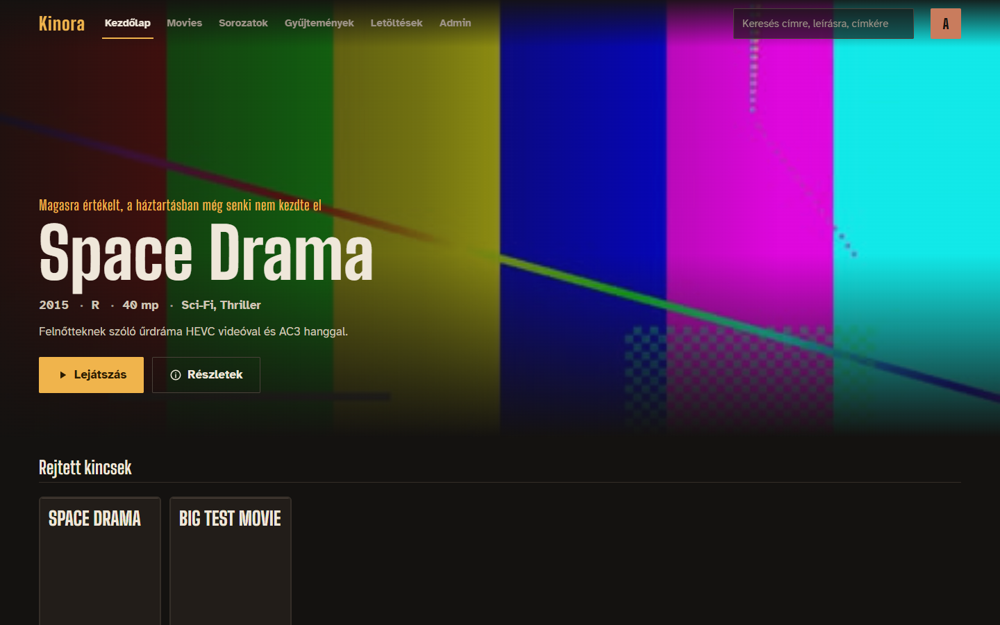
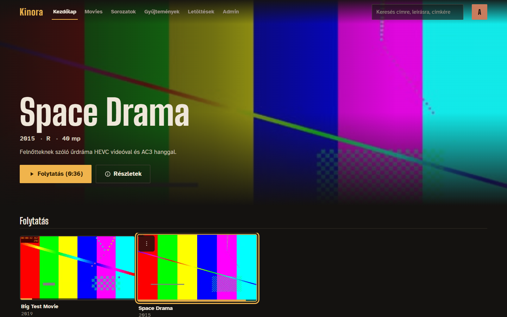
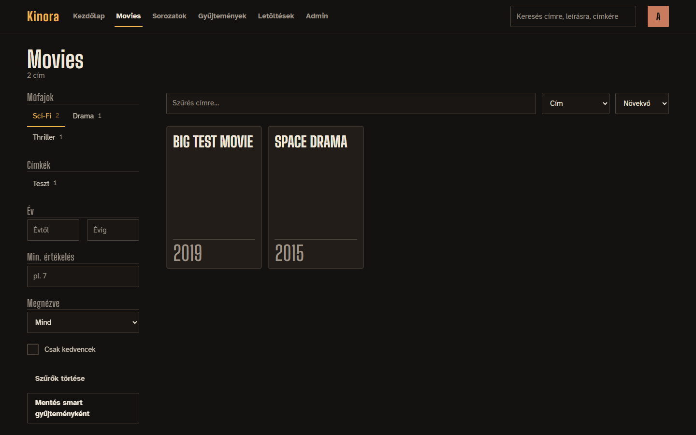
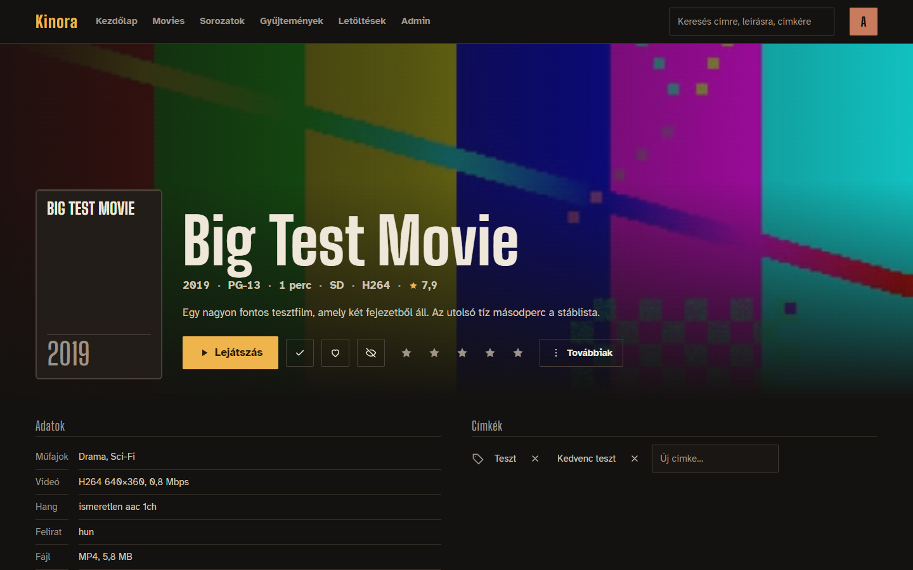
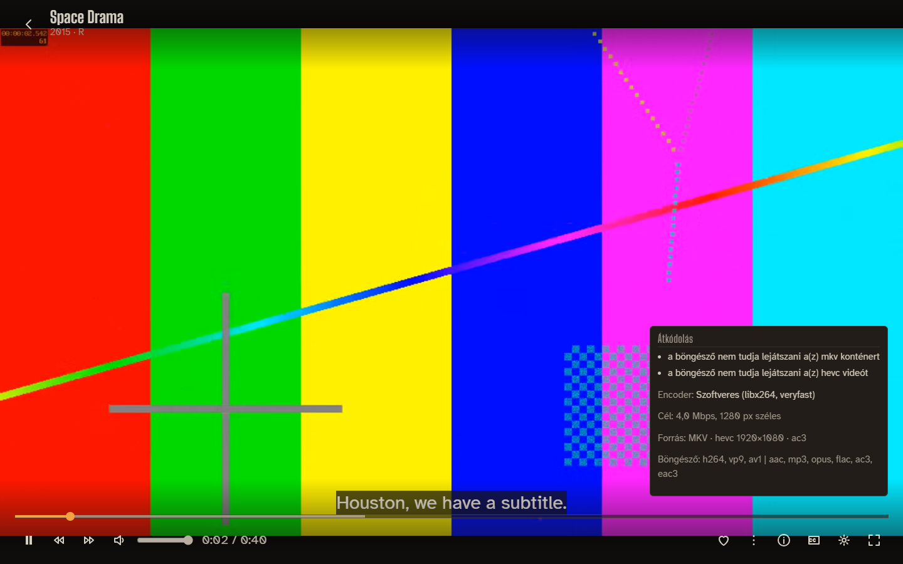
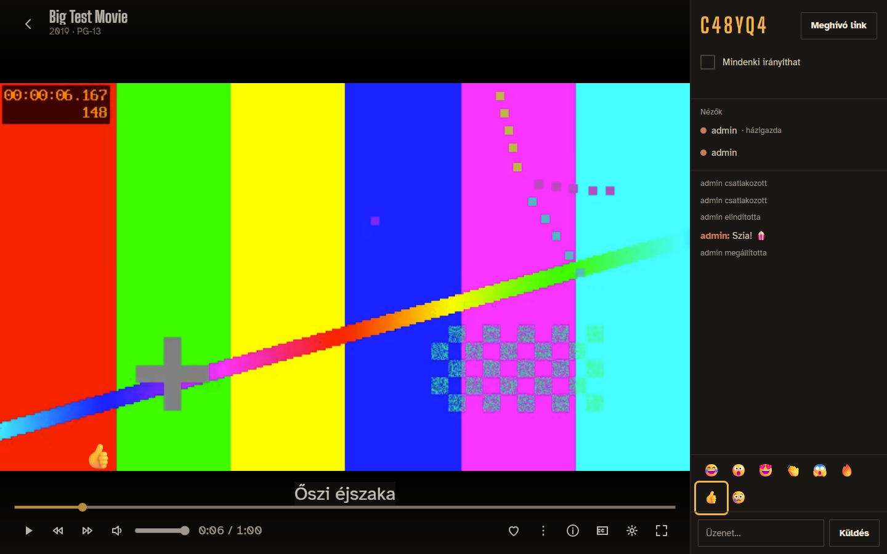
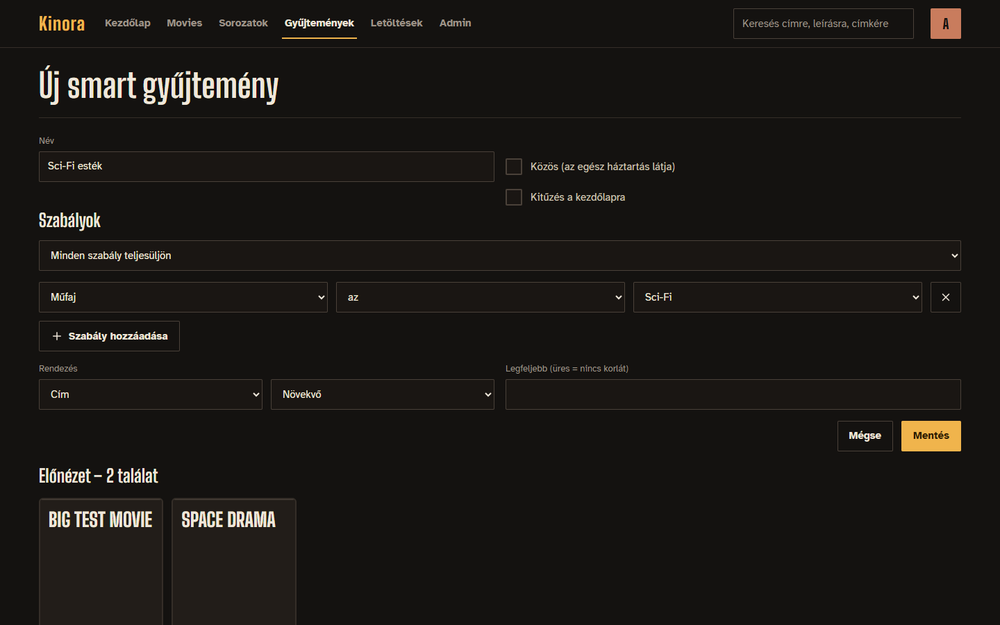
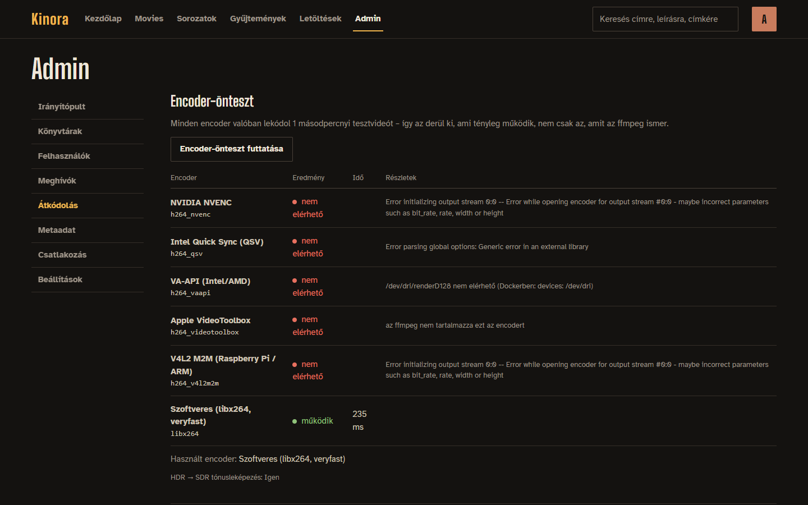
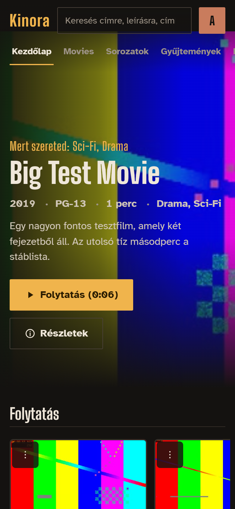

# Kinora

Saját gépen futó médiaszerver filmekhez és sorozatokhoz – a Jellyfin és a Plex alternatívája, magyar felülettel.
A neve az 1890-es évek kézi „mozgókép-nézegetőjéből” jön.

Egyetlen Go bináris, beágyazott webes klienssel; SQLite adatbázis; az ffmpeg végzi az átkódolást.
Az elsődleges telepítési mód a Docker.



## Telepítés Dockerrel (ajánlott)

```yaml
# docker-compose.yml
services:
  kinora:
    image: ghcr.io/scotylucas/kinora:latest
    container_name: kinora
    ports: ["8096:8096"]
    environment:
      - TZ=Europe/Budapest
      - PUID=1000
      - PGID=1000
    volumes:
      - ./config:/config
      - ./cache:/cache
      - /path/to/movies:/media/movies:ro
      - /path/to/shows:/media/shows:ro
    # Intel/AMD hardveres gyorsítás:
    # devices: ["/dev/dri:/dev/dri"]
    # group_add: ["video", "render"]
    restart: unless-stopped
```

```sh
docker compose up -d
```

Ezután nyisd meg: `http://<szerver-ip>:8096`. Az első indításkor egy varázsló kéri a szerver nevét és az admin fiókot,
majd az **Admin → Könyvtárak** oldalon add hozzá a `/media/movies` és `/media/shows` mappát (a mappaválasztó eleve a `/media` mappában nyílik meg).

| Mappa a konténerben | Mire való | Mentsd? |
|---|---|---|
| `/config` | adatbázis (`kinora.db`), poszterek és képek | **igen** |
| `/cache` | átkódolt szegmensek, letöltések, feliratcache | nem kell |
| `/media/...` | a filmjeid, **csak olvasható** (`:ro`) – a Kinora soha nem ír ide | – |

### Környezeti változók

Minden beállítás megadható környezeti változóval is. Ilyenkor az admin felületen a mező zárolva van („környezeti változóból beállítva”).

| Változó | Alapérték | Leírás |
|---|---|---|
| `KINORA_ADDR` | `:8096` | figyelt cím |
| `KINORA_DATA` | `/config` (natívan `./data`) | adatbázis, képek |
| `KINORA_CACHE` | `/cache` (natívan `<data>/cache`) | átkódolás, letöltések |
| `KINORA_PUBLIC_URL` | – | nyilvános cím (meghívó linkekhez, QR-kódokhoz) |
| `KINORA_TMDB_KEY` | – | TMDB API kulcs (v3 kulcs vagy v4 token) |
| `KINORA_METADATA_LANG` | `hu-HU` | metaadat nyelve |
| `KINORA_ENCODER` | `auto` | `auto`, `h264_nvenc`, `h264_qsv`, `h264_vaapi`, `libx264` … |
| `KINORA_VAAPI_DEVICE` | `/dev/dri/renderD128` | VA-API eszköz |
| `KINORA_SCAN_INTERVAL_MIN` | `15` | periodikus szkennelés (perc, 0 = ki) |
| `KINORA_SERVER_NAME` | `Kinora` | szerver neve |
| `KINORA_LOG_FORMAT` | szöveg | `json` esetén JSON naplózás (a `docker logs` mindkettőt mutatja) |
| `KINORA_LOG_LEVEL` | `info` | `debug` |
| `KINORA_FFMPEG`, `KINORA_FFPROBE` | `ffmpeg`, `ffprobe` | saját ffmpeg útvonala |
| `TZ`, `PUID`, `PGID` | `UTC`, `1000`, `1000` | időzóna, a fájlok tulajdonosa |

### Melyik image-et válaszd?

| Tag | Mit tud | Méret (tömörítve / kicsomagolva) | Mikor válaszd |
|---|---|---|---|
| `latest` (és `vX.Y.Z`, `edge`) | szoftveres kódolás, **Intel** VA-API/Quick Sync (amd64), **NVIDIA** NVENC | ~165 MB / ~615 MB | Az esetek többségében: Intel iGPU-s NAS vagy mini PC, NVIDIA kártya, Raspberry Pi, vagy ha nincs GPU. |
| `latest-amd` (és `vX.Y.Z-amd`, `edge-amd`) | ugyanez, plusz **AMD** Radeon VA-API (Mesa radeonsi) | ~225 MB / ~855 MB | Csak AMD GPU-hoz vagy AMD APU-hoz (Ryzen iGPU), ha hardveres kódolást akarsz. |

Mindkettő amd64-re és arm64-re is elérhető (multi-arch manifest). Ha nem tudod, melyik kell, indítsd a `latest`-et, és nézd meg az
**Admin → Átkódolás** oldalon az encoder-önteszt eredményét. Ha AMD géped van, és a VA-API ott „nem elérhető”, válts `latest-amd`-re.

### Hardveres gyorsítás

- **Intel / AMD (VA-API, Quick Sync):** AMD GPU-hoz a `latest-amd` image kell. Vedd ki a kommentet a `devices: ["/dev/dri:/dev/dri"]` sor elől. Az entrypoint
  automatikusan belép abba a csoportba, amelyiké a `/dev/dri/*` eszköz (a render/video GID rendszerenként más), így a `group_add` sor el is hagyható.
- **NVIDIA:** NVIDIA driver + [NVIDIA Container Toolkit](https://docs.nvidia.com/datacenter/cloud-native/container-toolkit/) kell, majd:
  `docker compose -f docker-compose.yml -f docker-compose.nvidia.yml up -d`
- Az **Admin → Átkódolás** oldalon a Kinora minden encoderrel *ténylegesen* lekódol egy 1 másodperces tesztklipet, és megmutatja,
  melyik működik, mennyi idő alatt, és ha nem, mi a hibaüzenet. Az automatikus választás sorrendje: a beállított encoder, ha működik → az első működő
  hardveres encoder → szoftveres libx264.

### NAS tippek

- **Unraid:** Docker → Add Container, repository `ghcr.io/scotylucas/kinora:latest`, port 8096, path-ok: `/config` → `/mnt/user/appdata/kinora`,
  `/media` → `/mnt/user/media` (read only). `PUID=99`, `PGID=100` (nobody:users). Intel iGPU-hoz: Extra Parameters: `--device=/dev/dri`.
- **TrueNAS SCALE:** Custom App, a dataseteket hostPath-ként csatold, `PUID`/`PGID` legyen annak a felhasználónak az azonosítója, akié a dataset
  (általában `568:568` – apps). GPU: „GPU Configuration” → Intel/AMD.
- **Synology (Container Manager):** a `PUID`/`PGID` értékét SSH-n az `id <felhasználó>` paranccsal kérdezd le. A `/dev/dri` csak olyan modelleken érhető el,
  amelyekben Intel processzor van (pl. a „+” sorozat egy része). A `@eaDir` és `#recycle` mappákat a szkenner automatikusan kihagyja.
- Hálózati megosztás (SMB/NFS) esetén ha a megosztás leesik, a Kinora **nem töröl semmit**: a szkennelés hibával leáll, a hiányzó fájlok csak
  „hiányzó” jelölést kapnak, és visszatéréskor megmarad a megnézett állapotuk.

### Natív bináris (másodlagos lehetőség)

Szükséges: Go 1.24+, C fordító (a sqlite miatt cgo kell), valamint `ffmpeg` és `ffprobe` a PATH-on.

```sh
go build -o kinora ./cmd/kinora
./kinora --data ./data          # http://localhost:8096
```

## Miért jobb, mint a Jellyfin

| Jellyfin-panasz | A Kinora megoldása |
|---|---|
| Nagy könyvtárnál lassú a szkennelés, és közben belassul a felület | Inkrementális szkenner: egy változatlan fájl egyetlen `stat()`; ffprobe csak az új vagy változott fájlokra fut, legfeljebb 6 szálon; SQLite WAL mód és rövid tranzakciók, így böngészés közben semmi nem blokkol. A második szkennelés a tesztkönyvtáron kb. 200 ms. |
| Átnevezés vagy áthelyezés után elveszik a megnézett állapot | Áthelyezés-felismerés: egy eltűnt fájl és egy új, azonos méretű fájl ugyanaz az elem, így megmarad az azonosítója és a megnézett állapota is. |
| SMB/NFS kiesésekor eltűnik a könyvtár | Ha a gyökérmappa nem érhető el, vagy hirtelen üres lett, a szkennelés leáll és nem nyúl semmihez. Egy eltűnt fájl csak `missing` jelölést kap, nem törlődik. |
| „Rejtélyes” transzkóder-hibák | Valódi encoder-önteszt, valamint a lejátszóban egy „Miért így megy?” panel: magyar nyelvű indokok (pl. „a böngésző nem tudja lejátszani a(z) hevc videót”), a használt encoder, a forrás és a böngésző képességei. Hiba esetén az ffmpeg utolsó hibasora jelenik meg. |
| Nincs átkódolt letöltés offline nézéshez | Letöltés 1080p/720p/480p/360p minőségben vagy eredeti fájlként, a háttérben, előrehaladás-jelzéssel. Faststart MP4, 7 napig marad meg. |
| A SyncPlay akadozik | Watch party szerver oldali órával: NTP-szerű óraszinkron, kis eltérésnél `playbackRate` 0,95/1,05, nagy eltérésnél ugrás. Ha valaki pufferel, mindenki megvárja, de legfeljebb 12 másodpercig. Van chat és emoji-reakciók is. |
| Nincs saját címke, gyűjtemény, értelmes szűrés | Saját címkék, kézi gyűjtemények sorrenddel, szabályalapú smart gyűjtemények (18 mező, all/any), összetett szűrés és rendezés. A részletes oldalon látszik, mely gyűjteményekben szerepel az elem. |
| Smart lista csak pluginnel | Beépített szabálymotor, a szerkesztőben élő előnézettel; a gyűjtemények a kezdőlapra is kitűzhetők. |
| Nincs „Mert megnézted…” | Teljesen helyi, magyarázható ajánló: „Neked ajánljuk” („mert szereted: Sci-Fi, Drama”), „Mert megnézted: X”, „Rejtett kincsek”, valamint „Hasonló” sor a részletes oldalon. |
| Egy sorozatot csak megnézettnek jelölve lehet eltüntetni a Next Up-ból | Elrejtés megnézettnek jelölés nélkül. Ha újra elkezded nézni, magától visszakerül. |
| Nincsenek igazi profilok és gyerekmód | Fiókonként 8 profil, opcionális PIN, gyerekprofil korhatár-szinttel. A szűrés **minden** végponton érvényes: listában, részleteken, keresésben, ajánlóban, streamen, feliratnál, letöltésnél, képeknél és a watch partyban. |
| Bonyolult felhasználófelvétel | Meghívólink felhasználásszámmal és lejárattal, QR-kóddal. |
| Bonyolult távoli elérés | „Csatlakozás” oldal: az összes LAN- és Tailscale-cím QR-kóddal, valamint útmutató Tailscale-hez, Cloudflare Tunnelhez és reverse proxyhoz. |
| A feliratlista tele van felesleges nyelvekkel | Profilonként felirat- és hangsávnyelv-prioritás; a menü alapból csak ezeket mutatja, az „Összes nyelv mutatása” kapcsolóval jön a többi. |
| Nincs „Következő rész” felugró | A stáblista kezdetét fejezetcímekből ismeri fel (credits, stáblista, end titles…), ennek híján az utolsó 30 másodpercben jelez. Visszaszámlálással indítja a következő részt. |
| A magyar `.srt` ékezetei elromlanak | A nem UTF-8 külső feliratot CP1250-ként olvassa be („Árvíztűrő tükörfúrógép” helyesen jelenik meg). |
| Gyenge mentés | Egy kattintásos, konzisztens adatbázis-mentés (`VACUUM INTO`) futás közben is. |

## Mappastruktúra

```
Movies/
  Blade Runner 2049 (2017)/Blade Runner 2049 (2017).mkv     ← a mappanév az elsődleges
  Blade Runner 2049 (2017)/movie.nfo, poster.jpg, fanart.jpg
  Blade Runner 2049 (2017)/Blade Runner 2049 (2017).hu.srt  ← <videónév>.<nyelv>[.forced].srt|vtt|ass
  The.Matrix.1999.1080p.BluRay.x264.mkv                     ← „The Matrix” (1999)
Shows/
  Breaking Bad (2008)/tvshow.nfo, poster.jpg
  Breaking Bad (2008)/Season 01/Breaking.Bad.S01E02.mkv
  Dark/Staffel 2/03 - Ghosts.mkv                            ← évadmappa + sorszám
  Aranyélet/2. évad/Aranyelet.S02E04.mkv
  Futurama/Specials/Futurama.S00E01.mkv                     ← 0. évad
  Seinfeld.S03E10.The.Old.Man.mkv                           ← lapos elrendezés is működik
```

- Felismert minták: `S01E02`, `S01E01E02` (dupla rész), `1x05`, évadmappa + `03 - Cím`. Évadmappák: `Season 01`, `S1`, `Staffel 2`,
  `Évad 2`, `2. évad`, `Specials`/`Extras` (= 0. évad).
- Kimarad: rejtett mappák, `@eaDir`, `#recycle`, `trailers`, `featurettes`, `behind the scenes`, valamint a 300 MB alatti `sample`/`-trailer` fájlok.
- Helyi metaadat: Kodi/Jellyfin-kompatibilis NFO (`movie.nfo`, `<videó>.nfo`, `tvshow.nfo`). Képek: `poster`/`folder`/`cover`,
  `fanart`/`backdrop`/`background`, `<videó>-poster`, `<videó>-thumb`, `season01-poster.jpg`. Ha nincs kép, a Kinora a videó kb. 20%-ánál készít egy képkockát.
- Online metaadat (opcionális): **Admin → Metaadat**, TMDB kulccsal. A helyi NFO-t és a kézzel javított elemeket soha nem írja felül.
  Rossz találat esetén a részletes oldalon a „Találat javítása” gombbal választhatsz másikat.

## Távoli elérés

**Tailscale** (a legegyszerűbb, nem kell portot nyitni): egy sidecar konténer csatlakozik a tailnetedhez, és a Kinora annak a hálózatán fut.

```sh
TS_AUTHKEY=tskey-... docker compose -f docker-compose.yml -f docker-compose.tailscale.yml up -d
```

A tailneten ezután `http://kinora:8096` címen éred el (MagicDNS), a helyi hálózaton továbbra is a megszokott címen.

**Cloudflare Tunnel** (saját domain, HTTPS): a Zero Trust felületén hozz létre egy tunnelt, a public hostname mutasson a `http://kinora:8096` címre, majd:

```sh
CF_TUNNEL_TOKEN=... KINORA_PUBLIC_URL=https://kinora.pelda.hu \
  docker compose -f docker-compose.yml -f docker-compose.cloudflared.yml up -d
```

Figyelem: a Cloudflare felhasználási feltételei korlátozhatják a nagy mennyiségű videóforgalmat a tunnelen.

**Reverse proxy:** a watch party WebSocketet használ, ezért add tovább az `Upgrade` és `Connection` fejléceket. Caddy-vel ehhez elég ennyi:
`reverse_proxy 127.0.0.1:8096`. Nginx-re kész példát találsz az **Admin → Csatlakozás** oldalon. A Kinora követi az `X-Forwarded-Proto`
fejlécet: HTTPS mögött a session cookie `Secure` jelzést kap.

Natív (Android/iOS/TV) kliensek a `POST /api/login` válaszában kapott tokent `Authorization: Bearer <token>` fejlécben küldhetik.

## Mentés és visszaállítás

- **Admin → Beállítások → Adatbázis-mentés letöltése:** konzisztens pillanatkép (`VACUUM INTO`), futás közben is biztonságos.
- Visszaállítás: állítsd le a konténert, másold a mentést `config/kinora.db` néven a helyére, töröld a `kinora.db-wal`/`-shm` fájlokat, majd indítsd újra.
  A képeket (`config/images`) a következő szkennelés újra legenerálja, ha hiányoznak.

## Az ffmpeg választásáról

A kép a **Debian bookworm saját `ffmpeg` csomagját** használja (5.1, `libzimg`/zscale tónusleképezéssel, VA-API, QSV (libmfx), NVENC (ffnvcodec)).
Mellette van az `intel-media-va-driver-non-free` (amd64, Gen8+ Intel iGPU), az `-amd` változatban pedig a `mesa-va-drivers` (AMD) is. Miért nem a `jellyfin-ffmpeg`?

- Ugyanabból a Debian-tárolóból jön amd64-re és arm64-re is, így a multi-arch build egyszerű és reprodukálható.
- A Kinora csak H.264 kimenetet és a szabványos `zscale`+`tonemap` láncot használja, ehhez nem kell a jellyfin-ffmpeg saját OpenCL/Vulkan tónusleképezése.
- A Kinora encoder-öntesztje úgyis megmutatja, mi működik az adott gépen.

Ha a jellyfin-ffmpeg kell (pl. újabb Intel Arc GPU-khoz), egy saját képben telepítsd, és add meg a
`KINORA_FFMPEG=/usr/lib/jellyfin-ffmpeg/ffmpeg` és `KINORA_FFPROBE=/usr/lib/jellyfin-ffmpeg/ffprobe` változót.

**Képméret.** A Debian ffmpeg-je a `libavdevice → libgl1 → … → libgl1-mesa-dri → libllvm15` láncon keresztül behúzza a Mesa OpenGL-drivereit
és az LLVM-et (kb. 140 MB). Az ffmpeg parancssori eszköz soha nem hoz létre OpenGL kontextust, ezért az alap (`latest`) image-ből a build
`dpkg --force-depends`-szel eltávolítja a `libgl1-mesa-dri`, `libllvm15` és `libz3-4` csomagot. Rögtön utána egy tesztkódolás is lefut,
ami ellenőrzi, hogy az ffmpeg ép. Ennek az ára, hogy az image-en belül az `apt` hiányzó függőséget jelez; a konténert nem is erre szánták.
A `latest-amd` image-ben ezek megmaradnak, mert az AMD VA-API driver (radeonsi) valóban használja az LLVM-et.
Maga a Kinora bináris kb. 10 MB.

Saját build: `docker build --target runtime .` (alap) vagy `docker build --target runtime --build-arg AMD=1 .` (AMD).

## Fejlesztés

```sh
go run ./cmd/kinora --data ./data --web ./web/static      # a webkliens a forrásból, frissítés után azonnal látszik
docker compose -f docker-compose.yml -f docker-compose.dev.yml up --build
```

Ha nincs helyi Go vagy C fordító, a `scripts/go.sh` a toolchaint konténerben futtatja:

```sh
scripts/mkmedia.sh testmedia          # generált tesztkönyvtár (ffmpeg kell hozzá)
scripts/go.sh go vet ./...
scripts/go.sh go test ./...           # unit- és integrációs tesztek valódi médiafájlokkal
scripts/smoke.sh                      # image build + konténer + curl-ös végigjárás (setup → szkennelés → lejátszás → HLS)
BASE=http://127.0.0.1:18097 node scripts/e2e.mjs   # böngészős E2E (Playwright + Edge/Chrome), képernyőképekkel
```

Felépítés:

```
cmd/kinora/        belépési pont, flagek/env, graceful shutdown, healthcheck alparancs
internal/store/    SQLite séma és migrációk, auth/profilok/meghívók, elemek, szabálymotor, gyűjtemények, ajánló
internal/scanner/  fájlnév-felismerés, inkrementális szkenner, NFO, képek
internal/media/    ffprobe, lejátszási döntés, encoder-önteszt, HLS sessionök, WebVTT, letöltések
internal/meta/     opcionális TMDB metaadat
internal/party/    watch party hub (WebSocket)
internal/server/   HTTP API, middleware, webkliens kiszolgálása
web/static/        vanilla JS SPA (index.html, app.js, style.css, vendor/hls.js, vendor/qrcode-generator)
```

A webkliens összes szövege az `app.js` elején, a `T` objektumban van, így az angol fordítás egy helyen elvégezhető.

### Tudatosan későbbre hagyva (v2)

Beépített relay/NAT-áttörés, natív Android/iOS/TV kliensek (a Bearer tokenes API már támogatja őket), intro-felismerés audio-ujjlenyomattal,
trickplay előnézeti képek, zenei könyvtár, élő TV, hiányzó gyűjteményelemek TMDB-ből, Postgres, angol fordítás.

## Dizájn

A felület a „kivilágított mozihomlokzat” gondolatára épül: a poszterek megvilágított plakáttartókban ülnek, az egyetlen akcentszín (borostyán)
csak annak jár, ami éppen „él” – a fókuszált kártya, a lejátszás, a haladás, az egyetlen elsődleges gomb. Két regiszter van ugyanazokból a
tokenekből: az **előcsarnok** (böngészés: a kép vezet, a felület hátralép) és a **vetítőfülke** (admin, szerkesztők: hajszálvonalak, táblák, tabuláris számok).

- Minden érték design token a `style.css` elején (`:root`): színskála, 4/8-as térköz-skála, betűméret-skála, két lekerekítés, 44 px-es érintési minimum, mozgás-időzítés.
- Betűk saját kiszolgálásból (`web/static/fonts`, SIL OFL): **Big Shoulders Display** a címekhez és számokhoz, **Atkinson Hyperlegible** a szövegekhez – mindkettő tartalmazza az ő/ű-t.
- Távirányító/billentyűzet: a nyilak térben mozgatják a fókuszt a sorok és rácsok között, a fókuszált plakáttartó kigyullad, és a kezdőlap homlokzata arra a filmre vált; Enter nyit, Esc visszalép.
- Kép nélküli könyvtárnál a kártya tipográfiai címkártya (cím + év), nem üres doboz.
- A régi felület képei összehasonlításhoz: `docs/screenshots/before/`.

## Képernyőképek

| | |
|---|---|
|  |  |
|  |  |
|  |  |
|  |  |

## Licenc

MIT. A vendorolt `hls.js` (Apache-2.0) és `qrcode-generator` (MIT) saját licence a `web/static/vendor/` mappában van.
